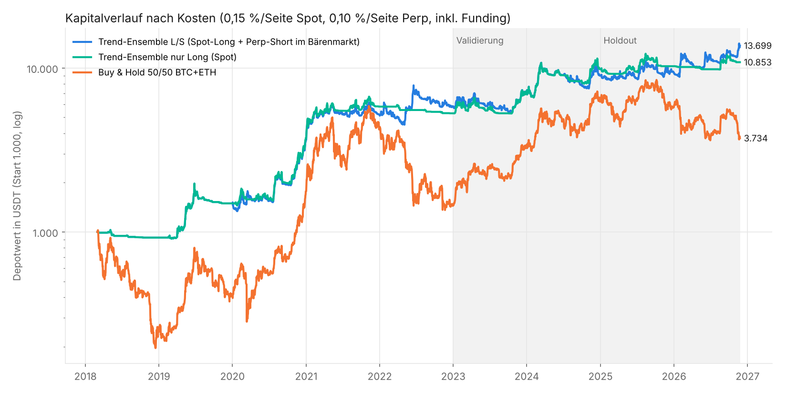
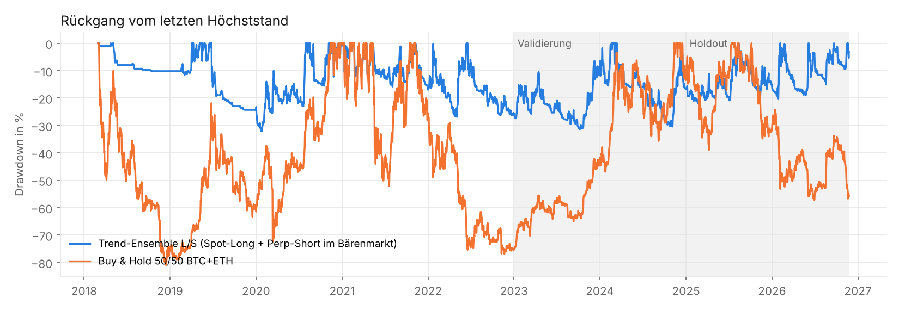
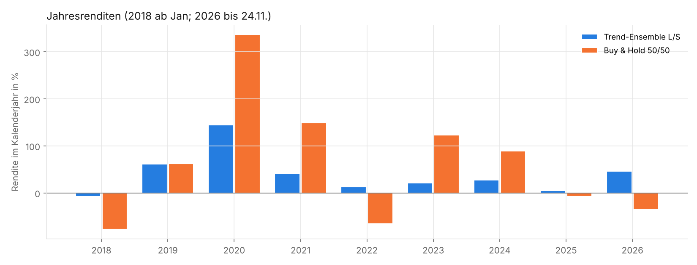

# Forschungsbericht: Robuste Krypto-Strategie für den Freqtrade-Bot

**Stand:** 25.11.2026 · **Daten:** Binance, 08/2017 – 24.11.2026 · **Status:** Forschung, nur Papertrading.
Alle Zahlen stammen aus den Skripten in `research/experiments/` und den Freqtrade-Ausgaben in `research/results/`.
Historische Backtests sind **keine** Prognose und **keine** Gewinnzusage.

---

## 0. Kurzfassung

1. **TrendGuard1h hat keinen nachweisbaren Vorteil.** Mit echtem Freqtrade 2026.10 über 2018–2026 getestet:
   593 Trades, **−13,5 %**, Profit-Faktor 0,78, in **8 von 9 Jahren negativ** (Markt +237 %). Der
   Durchschnittstrade (−0,23 %) entspricht etwa den Gebühren → das Einstiegssignal ist vor Kosten ≈ Zufall.
2. **Kurze Timeframes (5m/15m/1h) sind nach realistischen Kosten durchweg unprofitabel.** Alle 18 getesteten
   Varianten (Mean Reversion 1h/15m, Breakouts 15m/5m) verlieren in *jedem* Zeitraum Geld.
3. **Was robust funktioniert: langsame Trendfolge (Tage bis Wochen) auf 4h-Kerzen** – aber nicht als einzelner,
   optimierter Indikator, sondern als **Ensemble aus 11 Standard-Trendsignalen** mit **Volatilitätssteuerung**.
4. Der Finalist **TrendEnsembleSpot4h** (Spot, nur Long, BTC+ETH) erzielte in Freqtrade nach 0,15 % Kosten je Seite:

   | Zeitraum | CAGR | Max. Drawdown | Sharpe | Markt (BTC+ETH) |
   |---|---:|---:|---:|---:|
   | Entwicklung 03/2018–2022 | **+34,1 %** | 23,9 % | 1,36 | +50,6 % gesamt |
   | Validierung 2023–2024 | **+31,9 %** | 22,8 % | 1,16 | +324 % gesamt |
   | Holdout 2025–11/2026 | **+5,2 %** | 18,6 % | 0,39 | **−43 %** gesamt |
   | Gesamt 03/2018–11/2026 | **+26,7 %** | 23,9 % | 1,14 | +282 % gesamt |

   Er ist in allen Zeiträumen positiv, besteht Kostenstress, Parametervariation, Verzögerungstests und die
   Freqtrade-`lookahead-analysis` („no bias detected“).
5. **Ehrliche Einschränkungen:** Im Bärenmarkt 2025–26 schützt die Strategie Kapital, verdient aber kaum. In
   Bullenmärkten liegt sie weit hinter Buy & Hold (2020: +150 % vs. +336 %). Die Gewinne kommen aus wenigen
   großen Trends; Trefferquote der Einzeltrades nur ~16 % (Ø Haltedauer ~13 Tage), monatelange Seitwärtsphasen sind normal.
   Deflated Sharpe Ratio 0,83–0,91 (ordentlich, aber unter der strengen 0,95-Schwelle).
6. **Short-Komponente** (Perp-Short nur im Bärenregime) bringt im Holdout deutlich mehr (+25 % p.a. statt +5 %),
   ist allein aber schwach (≈ 4 % p.a., Drawdown 27–40 %). Empfehlung: nur als separates Forschungs-Papertrading.
7. **Funding-Carry** (marktneutral) war 2020–24 attraktiv, bringt 2025–26 aber nur noch ~1–2 % p.a. – derzeit nicht lohnend.
8. **Empfehlung:** TrendEnsembleSpot4h als **zweiten, getrennten Dry-Run-Bot** starten (Anleitung in
   `freqtrade/README.md`), TrendGuard1h unverändert weiterlaufen lassen, Ergebnisse über **Monate** vergleichen.

---

## 1. Ausgangslage und Umfang

- Grundlage: Projektübergabe vom 25.11.2026 und `TrendGuard1h.py`.
- **Codex-Ergebnisse vom 23.11.** (`Forschungsbericht.pdf`, `Quantitative-Research.zip`, `Marktdaten.zip`) lagen
  **nicht** vor: Das GitHub-Repository war zu Beginn leer. Sie konnten daher nicht geprüft werden; diese
  Untersuchung ist vollständig unabhängig davon. Wenn du die Dateien hochlädst, kann ich sie gegen die hier
  aufgebaute Pipeline (gleiche Daten, gleiche Kosten) nachrechnen.
- Kein Zugriff auf den Proxmox-Server; am laufenden Bot wurde nichts verändert.
- Der Forschungsrahmen wurde **vor** den Experimenten in `research/RESEARCH_PROMPT.md` festgelegt.

## 2. Daten

Quelle: öffentliches Binance-Archiv `data.binance.vision` (die Binance-API ist aus dem Cloud-Rechenzentrum
standortbedingt gesperrt; das Archiv enthält dieselben Kerzen). Downloader: `research/scripts/download.sh`.

| Datensatz | Umfang |
|---|---|
| Spot 1h (4h/1d daraus aggregiert) | 16 Coins: BTC, ETH, BNB, SOL, XRP, ADA, DOGE, LTC, LINK, AVAX, DOT, TRX, ATOM, XLM, ETC, BCH; BTC/ETH ab 17.08.2017 (≈ 81.000 Kerzen je Coin) |
| Spot 15m / 5m | BTC, ETH (+SOL 15m) ab 2019 |
| USDT-M-Perpetuals 1h + Funding (8h) | 10 Coins ab 2020 |

Qualitätsprüfung (`results/data_quality.csv`): 0,03–0,21 % fehlende Kerzen (bekannte Binance-Ausfälle, größte
Lücke 33,5 h im Jahr 2018), **keine** inkonsistenten OHLC-Werte, Zeitstempelwechsel ms→µs (2025) korrekt behandelt.

**Abgleich mit deinem Server:** Original-Freqtrade auf diesen Daten reproduziert deine Ergebnisse praktisch exakt:

| TrendGuard1h | Dein Server | Hier |
|---|---|---|
| 2024–2025 | 135 Trades, 40/95, +0,28 %, DD 3,09 %, Markt +68,27 % | 135 Trades, 40/95, +0,29 %, DD 3,10 %, Markt +68,27 % |
| 2026 | 48 Trades, 8/40, −2,31 %, Markt −32,45 % | 48 Trades, 8/40, −2,31 %, Markt −32,59 % (1 Tag mehr Daten) |

## 3. Methodik

- **Zeitliche Trennung:** Entwicklung 2018–2022 (Bär 2018, Bulle 2020/21, Bär 2022), Validierung 2023–2024,
  Holdout 2025-01-01 bis 2026-11-24. Parameter wurden nur auf der Entwicklung gewählt.
- **Ausführung:** Signal auf Kerzenschluss, Ausführung zum nächsten Open; Stops intrabar, Gaps zum schlechteren
  Kurs, Stop vor Take-Profit (konservativ).
- **Kosten:** Spot 0,10 % Gebühr + 0,05 % Slippage **je Seite**; Perps 0,05 % + 0,05 %; Stress bis 0,40 %/Seite.
  Perps inklusive **historischer Funding-Raten**. Kein Hebel (1x).
- **Zwei unabhängige Implementierungen:** eigene Engine (`research/lib/engine.py`) und Original-Freqtrade 2026.10.
  Beide liefern für dieselbe Strategie nahezu identische Ergebnisse (siehe Abschnitt 6.4).
- **Anzahl getesteter Konfigurationen:** ≈ 271 (wird in der Deflated Sharpe Ratio berücksichtigt).

## 4. Diagnose TrendGuard1h (Freqtrade, 2018–2026)

| Kennzahl | Wert |
|---|---:|
| Trades | 593 |
| Gesamtergebnis | −13,49 % (CAGR −1,61 %) |
| Profit-Faktor | 0,78 |
| Negative Jahre | 8 von 9 (nur 2025 positiv) |
| Marktveränderung | +236,6 % |

Exit-Gründe: `trend_break` 435 Trades, Ø −1,09 %, Summe −47,6 %; `roi` 50 Trades +26,7 %; `trailing_stop` 81 Trades
+18,8 %; `stop_loss` 27 Trades −11,3 %.

**Ursachen:**
1. Das 1h-Einstiegssignal (RSI kreuzt 46 im Aufwärtstrend) hat brutto keinen messbaren Vorteil; Haltedauer ~16 h
   ist zu kurz, um die großen Krypto-Trends mitzunehmen, aber lang genug, um Rauschen zu handeln.
2. Die Gewinne werden durch ROI/Trailing bei +3–8 % gekappt, die Verluste laufen bis zum Trendbruch.
3. 100 USDT je Trade bei 1.000 USDT Wallet (max. 20 % investiert) macht die Kurve flach – der „geringe
   Drawdown“ ist eine Folge kleiner Positionen, kein Qualitätsmerkmal.

## 5. Ergebnisse der Strategiefamilien

### E1 – Trendfolge Long-only, BTC+ETH Spot, 4h (66 Varianten, `e1_trend.py`)

SMA-Filter, EMA-Kreuzung, Donchian-Breakout, Donchian+ATR-Trailing, Zeitreihen-Momentum, je mit/ohne Vol-Target.

| Familie (Median) | Sharpe Dev | Sharpe Val | Sharpe Holdout |
|---|---:|---:|---:|
| Donchian | 0,97–1,09 | 0,98–1,05 | 0,03–0,07 |
| SMA | 0,94–0,98 | 1,33–1,48 | −0,02–0,10 |
| EMA-Kreuzung | 0,87–0,94 | 1,00 | 0,33–0,39 |
| Momentum | 0,80–0,90 | 1,28–1,35 | −0,14 |
| Donchian + ATR-Trailing | 0,55–0,69 | ≈ 0 | −0,14 bis −0,19 |
| *Buy & Hold 50/50* | *0,49* | *1,70* | *−0,33* |

60 von 66 Varianten schlagen Buy & Hold in der Entwicklung beim Sharpe, alle 66 beim Drawdown – ein breites Plateau.
Im Holdout (Markt −24 % p.a.) liegen sie um null: Kapitalschutz ja, Gewinn nein. Enge ATR-Trailing-Stops schaden.

### E2 – Long/Short auf Perpetuals inkl. Funding (84 Varianten, `e2_longshort.py`)

| Modus (Median) | Sharpe Dev 2020–22 | Sharpe Val | Sharpe Holdout | CAGR Holdout |
|---|---:|---:|---:|---:|
| nur Long | 1,13–1,17 | 1,14–1,15 | 0,14–0,20 | +0,4 bis +1,8 % |
| Long/Short | 1,13–1,25 | 0,42–0,52 | 0,71–0,72 | +21 bis +25 % |
| Short nur im Bärenregime | 1,14–1,25 | 0,77–0,82 | 0,69–0,71 | +22 bis +23 % |

**Funding:** Ein dauerhafter Perp-Long hat 2020–26 ≈ 11,5 % (BTC) bzw. 13,6 % (ETH) **pro Jahr** gezahlt. Longs
gehören deshalb auf Spot, Shorts auf Perps (Shorts *erhalten* meist Funding).

### E3 – Trend-Ensemble (`e3_ensemble.py`) → Finalist

**Definition (vorab festgelegt, nicht optimiert):** 11 Trend-„Stimmen“ je Coin auf 4h-Kerzen, Lookbacks in Tagen:
SMA 20/50/100/200 (Kurs darüber = +1, darunter = −1), Donchian-Breakout 20/10 und 55/20, Momentum 30/90/180,
EMA-Kreuzung 10/30 und 20/100. `score` = Mittelwert ∈ [−1; +1].
Position = max(score, 0) × min(1; 50 % / realisierte 30-Tage-Volatilität) × Kapitalanteil des Coins.
Nachjustiert wird erst ab 5–10 % Abweichung (spart Gebühren). Short-Variante: |score| per Perp, nur wenn
Kurs < 200-Tage-SMA.

| BTC+ETH (eigene Engine) | Dev CAGR / Sharpe | Val | Holdout | Gesamt CAGR / Max DD / Sharpe |
|---|---|---|---|---|
| nur Long, ohne Vol-Target | 49,4 % / 1,20 | 36,4 % / 1,12 | 6,7 % / 0,42 | 36,2 % / −37,7 % / 1,06 |
| **nur Long, Vol-Target 50 %** | **39,6 % / 1,36** | **36,3 % / 1,18** | **5,3 % / 0,38** | **30,7 % / −26,6 % / 1,15** |
| L/S Bärenregime, Vol-Target 50 % | 42,3 % / 1,26 | 23,9 % / 0,83 | 25,0 % / 0,86 | 34,2 % / −32,3 % / 1,08 |
| L/S ungefiltert, Vol-Target 50 % | 44,1 % / 1,29 | 18,9 % / 0,70 | 29,2 % / 0,95 | 34,9 % / −35,4 % / 1,08 |
| 16 Coins, nur Long | 23,4 % / 1,31 | 19,6 % / 1,28 | 1,5 % / 0,19 | 17,5 % / −19,3 % / 1,13 |
| *Buy & Hold 50/50* | *7,1 % / 0,49* | *105,3 % / 1,70* | *−24,2 % / −0,33* | *15,2 % / −87,2 % / 0,55* |





### E4 – Wöchentliche Momentum-Rotation über 16 Coins (12 Varianten) – **verworfen**

Entwicklung bis +107 % p.a., Validierung bis +182 % p.a., aber **Holdout −10 bis −51 % p.a.**, Drawdowns bis −82 %.
Zusätzlich Survivorship-Bias (Universum aus heutiger Sicht). Typisches Beispiel für „sieht nur im Backtest gut aus“.

### E5 – Kurze Timeframes (18 Varianten × 2 Kostenszenarien) – **verworfen**

| Familie | Ergebnis nach Basiskosten |
|---|---|
| Mean Reversion RSI(2), 1h, mit/ohne Trendfilter | alle negativ in allen Zeiträumen (−11 % bis −90 % p.a.) |
| Mean Reversion RSI(2), 15m | alle negativ (−62 % bis −99 % p.a.) |
| Donchian+Volumen-Breakout, 15m | alle negativ (−16 % bis −58 % p.a.) |
| Donchian+Volumen-Breakout, 5m | alle negativ (−53 % bis −92 % p.a.) |

Selbst mit optimistischen 0,05 % Kosten je Seite ist keine Variante in Validierung *und* Holdout positiv.
≈ 230 bis 3.600 Trades pro Jahr × 0,3 % Round-Trip-Kosten fressen jeden Brutto-Vorteil auf.

### E9 – Funding-Carry: Spot-Long + Perp-Short, marktneutral (3 Varianten, `e9_carry.py`)

Kapital je Coin halb in Spot, halb als Margin für einen gleich großen 1x-Perp-Short; Ertrag = erhaltenes Funding
minus Kosten. Die Absicherung wird rebalanciert, sobald ein Bein > 2 % des Kapitals abweicht.

| Variante | CAGR Dev 2020–22 | Val | Holdout | Gesamt / Max DD |
|---|---:|---:|---:|---:|
| immer aktiv | 7,6 % | 4,9 % | 1,5 % | 5,1 % / −2,1 % |
| nur bei positivem 3-Tage-Funding | 5,3 % | 4,1 % | −0,9 % | 3,2 % / −3,5 % |

Jahre (immer aktiv): 2020 +5,4 · 2021 +16,6 · 2022 +0,1 · 2023 +3,8 · 2024 +6,0 · 2025 +2,0 · 2026 +0,8 %.
**Bewertung:** risikoarm im Kursverlauf, aber die Funding-Prämie ist 2025–26 auf ~1–2 % p.a. gefallen – weniger
als eine risikofreie Anlage, bei zusätzlichem Börsen-/Gegenpartei- und Margin-Risiko. Derzeit nicht lohnend.

*Transparenzhinweis:* Ein erster Lauf ohne Rebalancing zeigte unplausible +795 % für 2021. Ursache: Bei einer
nicht rebalancierten Absicherung wächst das Nominalvolumen beider Beine mit dem Kurs (BTC ×12), das Eigenkapital
nicht – ein verdeckter Hebel, bei dem der Short real längst liquidiert worden wäre. Korrigiert; E2–E4 sind
nicht betroffen (nur eine Richtung je Coin bzw. bereits mit Rebalancing-Band).

## 6. Robustheit des Finalisten

### 6.1 Variationen (eigene Engine; vollständige Tabellen `e6_robust_variants.csv`, `e8_longonly_robust.csv`)

| Variation | L/S-Bärenregime: CAGR Dev / Val / Holdout | Long-only: CAGR Dev / Val / Holdout |
|---|---|---|
| Basis | 42,3 / 23,9 / 24,9 % | 39,6 / 36,3 / 5,3 % |
| Kosten 0,25 %/Seite | 38,9 / 17,4 / 19,0 % | 37,6 / 31,1 / 3,3 % |
| Kosten 0,40 %/Seite | 34,6 / 9,0 / 12,1 % | 34,7 / 23,6 / 0,3 % |
| Lookbacks × 0,5 | 40,3 / 23,6 / 24,1 % | 37,5 / 33,9 / 6,8 % |
| Lookbacks × 2,0 | 38,5 / 16,5 / 14,8 % | 38,5 / 29,7 / −0,1 % |
| Vol-Target 30 % | 27,5 / 20,9 / 17,3 % | 25,1 / 30,5 / 2,5 % |
| Vol-Target 80 % | 48,6 / 22,8 / 22,1 % | 47,8 / 36,4 / 6,7 % |
| 1 Tag verzögerte Ausführung | 33,5 / 13,9 / 20,0 % | 34,5 / 35,0 / −0,8 % |
| Ausführung auf 1h bzw. 1d | positiv in allen Zeiträumen | positiv in allen Zeiträumen |

**Bewertung:** Kein Nadelspitzen-Optimum – alle Nachbarn bleiben in Entwicklung und Validierung deutlich positiv.
Die L/S-Variante bleibt auch im Holdout überall positiv; die Long-only-Variante liegt dort zwischen −1 % und +8 %.

### 6.2 Übertragbarkeit auf andere Coins (gleiche Parameter, kein Retuning)

- Long-only: Gesamtzeitraum auf 14 von 16 Coins positiv; Drawdown auf **16 von 16** Coins kleiner als Buy & Hold.
  Im Holdout aber nur auf 4 von 16 Coins positiv (Altcoins fielen 2025–26 stark).
- L/S-Bärenregime (10 Coins mit Perps): Holdout auf 7 von 10 positiv.

### 6.3 Jahresrenditen (L/S-Bärenregime vs. Buy & Hold 50/50)

| Jahr | 2018 | 2019 | 2020 | 2021 | 2022 | 2023 | 2024 | 2025 | 2026* |
|---|---:|---:|---:|---:|---:|---:|---:|---:|---:|
| Strategie L/S | −7,6 | +61,7 | +144,6 | +41,5 | +12,8 | +20,7 | +27,6 | +4,5 | +46,0 |
| Strategie Long-only | −7,6 | +61,7 | +149,8 | +55,8 | −9,0 | +32,6 | +40,1 | +4,3 | +5,8 |
| Buy & Hold 50/50 | −76,9 | +62,5 | +336,4 | +149,4 | −65,9 | +123,0 | +88,9 | −7,9 | −35,6 |

\* bis 24.11.2026. 

### 6.4 Gegenprüfung im Original-Freqtrade 2026.10

| Prüfung | Ergebnis |
|---|---|
| `TrendEnsembleSpot4h`, 03/2018–11/2026, Fee 0,15 % | +690 %, CAGR 26,7 %, Sharpe (täglich) 1,14, max. Wallet-Drawdown 23,9 %, Profit-Faktor 2,67, 245 Trades |
| Eigene Engine, gleiche Strategie | CAGR 30,7 %, Sharpe 1,15, Drawdown 26,6 % |
| `lookahead-analysis` | **No bias** (0 von 20 Signalen verzerrt) |
| `recursive-analysis` (199 … 1.999 Startkerzen) | keine relevanten Abweichungen (max. 0,000 %) |
| `TrendEnsembleBearShort4h` (Futures, 1x, Funding), 07/2020–11/2026 | +28,3 %, CAGR 4,0 %, Profit-Faktor 1,37, Drawdown 27,3 % |
| Eigene Engine, Short-Komponente | +28,1 %, CAGR 4,0 %, Sharpe 0,29 vs. 0,27 in Freqtrade |

Die Short-Komponente verdient nur in Bärenjahren (2022, 2026) und verliert in den anderen ~9 % p.a. –
als Ergänzung sinnvoll, allein nicht.

### 6.5 Walk-Forward – testet das Auswahlverfahren selbst (`e7_walkforward.py`)

Alle 6 Monate aus 27 Ensemble-Konfigurationen die mit dem besten Sharpe der letzten 3 Jahre wählen, dann 6 Monate
handeln (Out-of-Sample 2021–2026):

| Vorgehen | CAGR | Max DD | Sharpe |
|---|---:|---:|---:|
| Laufend „beste letzte Konfiguration“ wählen | 10,1 % | −29,9 % | 0,59 |
| **Feste, vorab gewählte Konfiguration** | **25,2 %** | −31,4 % | 0,85 |
| Gleichgewichteter Mix aller 27 | 22,3 % | −27,7 % | 0,90 |

**Konsequenz:** Häufiges Nach-Optimieren (z. B. regelmäßiges Hyperopt auf die letzten Monate) hätte hier
geschadet. Robustheit kommt aus Diversifikation über Parameter, nicht aus Optimierung.

### 6.6 Statistische Einordnung

| Kennzahl | L/S-Bärenregime | Long-only |
|---|---:|---:|
| Probabilistic Sharpe Ratio (Gesamtzeitraum, vs. 0) | 0,999 | 0,999 |
| PSR nur Holdout (23 Monate) | 0,89 | 0,70 |
| Deflated Sharpe Ratio (184–1.000 Trials angenommen) | 0,83–0,91 | – |
| Block-Bootstrap CAGR Gesamt (5 % / 50 % / 95 %) | 9,3 / 32,0 / 63,3 % | 10,7 / 31,3 / 60,3 % |
| Block-Bootstrap CAGR Holdout (5 % / 50 % / 95 %) | −15,0 / 19,9 / 71,9 % | −13,6 / 6,4 / 34,8 % |

Lesart: Über den gesamten Zyklus ist ein positiver Erwartungswert statistisch gut gestützt. Für die letzten
23 Monate allein ist die Unsicherheit groß – ein einzelnes Jahr kann klar negativ ausfallen.

## 7. Grenzen und Risiken

- **Die Vergangenheit enthielt außergewöhnliche Krypto-Trends** (2017–2021). Trendfolge lebt davon; bleiben große
  Trends aus, ist mit Seitwärtsphasen von 1–2 Jahren ohne neuen Höchststand zu rechnen (2022–2023 bereits einmal).
- **Underperformance im Bullenmarkt** ist systembedingt (Vol-Target begrenzt die durchschnittliche Investitionsquote auf ~20–50 %).
- **Holdout-Disziplin:** Die Holdout-Zahlen wurden für alle E1/E2-Varianten gemeinsam berechnet und angezeigt.
  Ausgewählt wurde trotzdem nach Entwicklung/Validierung; die gewählte L/S-Variante ist im Holdout sogar
  *schlechter* als die nicht gewählte ungefilterte – ein Hinweis, dass kein Holdout-Snooping stattfand.
  Der wirklich unberührte Test ist ab jetzt das Papertrading.
- **Survivorship-Bias** bei der 16-Coin-Analyse; für BTC/ETH irrelevant.
- **Ausführungsmodell:** Slippage pauschal; reale Fills bei großen Orders/Stressphasen können schlechter sein.
  Mark-Preis für Freqtrade-Futures durch Perp-Preis angenähert (Einfluss nur auf Funding-Berechnung, minimal).
- **Futures/Shorts:** theoretisch unbegrenztes Verlustrisiko, Liquidations- und Börsenrisiko, regulatorische
  Verfügbarkeit für dein Konto/Land muss separat geprüft werden. Nur Forschung/Papertrading.
- Freqtrade-Werte und eigene Engine unterscheiden sich leicht (CAGR 26,7 vs. 30,7 %), v. a. durch
  Startzeitpunkt (Warmup) und die Mechanik von Teilkäufen/-verkäufen.

## 8. Empfehlung

1. **TrendGuard1h nicht weiter optimieren** – es gibt kein Signal, das sich zu optimieren lohnt. Er kann als
   technischer Referenz-Bot weiterlaufen.
2. **TrendEnsembleSpot4h als zweiten, getrennten Dry-Run-Bot starten** (eigener Container, Port 8081, eigene DB,
   kein Eingriff in den bestehenden Bot) – Anleitung: `freqtrade/README.md`. Vorher auf dem Server die Daten
   herunterladen und den Backtest reproduzieren.
3. **Erwartung an das Papertrading:** ≈ 28 Trades pro Jahr (plus Teilkäufe/-verkäufe beim Rebalancing). Vier Wochen sagen über Profitabilität
   nichts aus – sie prüfen nur, ob Signale, Größen und Teilverkäufe wie im Backtest ablaufen. Bewertungshorizont
   mindestens 6–12 Monate, Vergleich gegen den Backtest desselben Zeitraums.
4. **Short-Komponente** erst als dritten Dry-Run-Bot (Futures-Modus), wenn der Spot-Bot technisch sauber läuft.
5. **Keine Echtgeld-Freigabe** ohne: mehrmonatiges Papertrading, das den Backtest im selben Zeitraum bestätigt,
   und deine ausdrückliche separate Entscheidung.

## 9. Mögliche weitere Forschung

- Diversifikation über mehr liquide Coins mit Volatilitätsgewichtung (16-Coin-Version: Drawdown −19 % statt −27 %),
  mit sauberem, historisch rekonstruiertem Universum (Survivorship-frei).
- Maker-Orders/Limit-Ausführung zur Kostensenkung (würde v. a. Rebalancing billiger machen).
- Echte Mark-Price-Daten für Futures, Funding-basierte Filter (z. B. Shorts nur bei positivem Funding).
- Funding-Carry (E9) bei wieder steigenden Funding-Raten neu bewerten; weitere unkorrelierte Module suchen.

## 10. Reproduktion

```bash
cd research
./scripts/download.sh                      # ~210 MB aus data.binance.vision
python3 scripts/build_data.py               # Parquet-Cache + Qualitätsbericht
cd experiments
python3 e1_trend.py; python3 e2_longshort.py; python3 e3_ensemble.py
python3 e4_rotation.py; python3 e5_short_tf.py; python3 e6_robust.py
python3 e7_walkforward.py; python3 e8_longonly_robust.py; python3 e9_carry.py; python3 charts.py
# Freqtrade-Gegenprüfung: siehe freqtrade/README.md
```
Benötigt: Python ≥ 3.11, pandas, numpy, numba, TA-Lib (`pip install ta-lib`), scipy, matplotlib, pyarrow.
